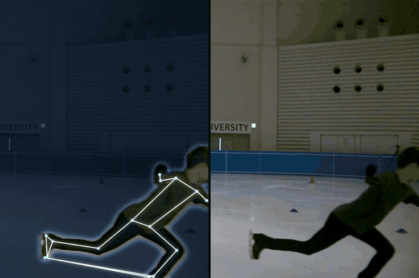
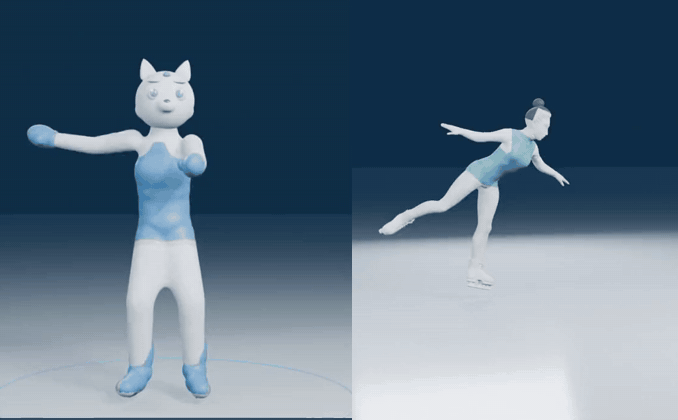

# JumpSight

> **Public overview.** The source code of JumpSight is private. This page
> describes what the system does, how it is built at a high level and what
> it measures. Reviewers can get read access to the full source on request —
> see [Access to the code](#access-to-the-code).

JumpSight analyses figure-skating jumps from a single phone video. For each
jump it reports the jump type, the number of revolutions the way judges count
them, take-off and landing times, air time, rotation speed and a set of
landing checks — each with a confidence level and the reason behind it.

Live: **https://jumpsight.pp.ua** (English and Ukrainian).

A jump lasts about half a second, a phone films at 30 frames per second, and
during fast rotation off-the-shelf pose models lose track of which way the
body faces. Most of the engineering went into measuring what can be measured
under those conditions, and saying plainly when something cannot be measured
from the frames.

## What it looks like

### Jump analysis

Left: what the engine measures. Right: the original frames. Played at half
speed. From the run on this clip (60 fps): take-off at frame 79, landing at
frame 117, 0.633 s in the air, 2.2 revolutions in flight.
Full quality: [jump-analysis.mp4](docs/media/jump-analysis.mp4).

### Exercise demonstrations with a 3D character

A coach films an exercise on a phone; the app teaches it with a 3D character
that performs the same movement, so neither the coach's footage nor voice is
shown. A clip is published only if it passes automatic accuracy gates against
the original video.
Full quality: [character-a.mp4](docs/media/character-a.mp4), [character-b.mp4](docs/media/character-b.mp4).

## What the product does

| Part | What the user gets |
|---|---|
| Jump analysis | the jump found in the video, take-off and landing, air time, revolutions, rotation speed, jump type, landing checks — each with a confidence and a reason |
| Web app and live mode | upload a video or record in the browser; in live mode the first answer arrives a few seconds after the landing |
| Coaching | a chat that answers from a curated knowledge base with sources, a daily session and a two-week plan built from the measured faults, a history of attempts, coach and student accounts |
| Exercise library | short 3D-character demonstrations of each exercise with an AI-generated voice-over |

## Principles

- **No invented numbers.** Every value is either measured from the frames,
  explicitly marked as inferred, or absent with a reason. The interface never
  fills a gap with a plausible-looking number.
- **Confidence next to every conclusion.** Lutz and flip differ only by the
  blade edge, which a single camera cannot see; the system shows them as a
  pair and never with high confidence.
- **The coach answers from sources.** Answers are grounded in a reviewed
  knowledge base; a statement that is not supported by a source is not shown.
- **Measured, not assumed.** Every design decision was checked on data with
  known truth, and ideas that did not improve the product were dropped.

## Measured results

| What | Result | Data |
|---|---|---|
| Revolutions in flight, flight window given | 214 of 221 measured, median error 0.029 rev, 212 of 214 within 0.25 rev | motion capture, 4 skaters, 30 fps |
| Jump name, strict | 33 of 54 | web and broadcast clips |
| Jump name, answers shown to the user | 32 of 37 correct, an answer on 37 of 54 | web and broadcast clips |
| Revolution count, end to end | 22 of 31 correct, a count on 31 of 54 | web and broadcast clips |

There is no labelled set of phone videos yet, so accuracy on the target input
is not known; landing checks have no measured sensitivity yet.

## Engineering at a glance

- Python 3.11 analysis engine as a separate package, run by the web app as a
  long-lived worker process.
- FastAPI backend, plain-JavaScript mobile web client (installable PWA),
  English and Ukrainian.
- Coaching service with retrieval over a knowledge base and a language model
  restricted to the retrieved sources.
- Offline 3D-character pipeline (motion recovery, retargeting, Blender render)
  with automatic quality gates.
- Deployed on Google Cloud Run (CPU only, about 30 s per analysis).
- About 37,000 lines of code and 1,000+ automated tests; architecture
  boundaries between packages are enforced by tests; CI on every change.

## Access to the code

The full source is private. If you are reviewing my work and want to read it,
contact me via [maxsaiets.com](https://maxsaiets.com) and I will grant
read access.

## Licence

All rights reserved. See [LICENSE](LICENSE).
