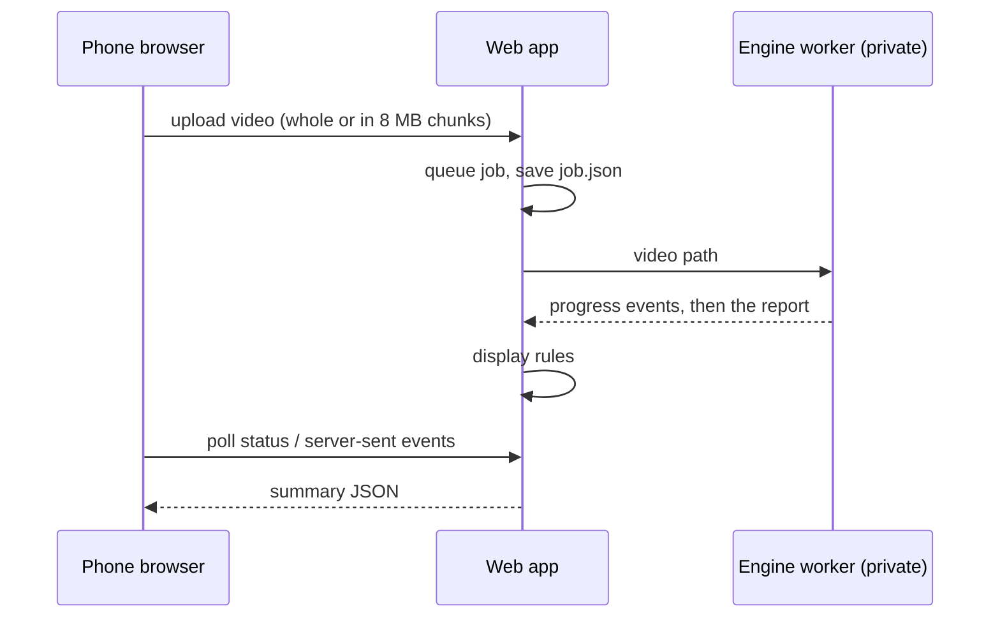
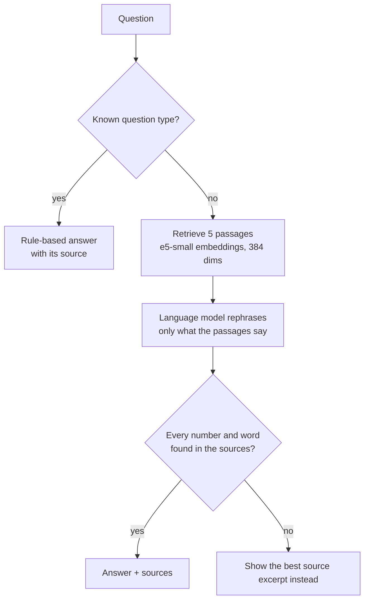

# How JumpSight works (public edition)

This document covers the parts of JumpSight that are in this repository: the
answer contract, the web application and the coaching service. The analysis
engine — how the jump is found, how take-off, landing and revolutions are
measured, how the jump is named — is private; reviewers can get access on
request (see the README).

## 1. The problem

A figure-skating jump is judged by three things: which jump it is, how many
revolutions were done in the air, and how it was landed. The jump type is
decided by the take-off: which foot, which edge, forward or backward, with or
without a toe pick. The flight and the landing look much the same for all six
jumps.

A phone video gives one camera view at about 30 frames per second. A double
jump flies for roughly 0.5 s, so the whole flight is about 15 frames. The
skater can be small in the frame, blurred, and turning at 3 to 5 revolutions
per second. The system has to work inside those limits and has to say when it
cannot.

## 2. The answer contract: every number explains itself

Every value the engine returns is a measurement object, for example the
revolutions of an Axel where the signal was clear but the uncertainty was wide:

```json
{
  "status": "degraded",
  "tier": "low",
  "unit": "rev",
  "ci68": [1.77, 3.01],
  "method": "<engine method id>",
  "reason": "REV_BAND_WIDER_THAN_HALF_TURN"
}
```

The user then sees "2 to 3 revolutions", not a guessed "2". `status` is one of
`measured`, `degraded`, `inferred`, `absent`; an `absent` value always carries
a reason, and nothing in the app replaces it with a plausible number. The
shared evidence format lives in `jumpsight_core/evidence.py`.

## 3. The application around the engine



- `webapp/` holds the upload endpoints (single, chunked, live parts), the job
  queue with honest states (`queued`, `scanning`, `running`, `done`, `error`
  with a code), status and server-sent events, and the summary endpoint.
- The engine sits behind `jumpsight_app/engine_bridge/`. In this edition the
  bridge is an interface only: `available()` is False and a job ends with
  `ENGINE_UNAVAILABLE` — the loud failure the app is designed for, never a
  made-up result.
- Live mode uploads the recording in parts while the user is still filming
  (`upload_parts.py`, `live_queue.py`, `webapp/live_local.py`), so the
  analysis can start before the recording stops.
- The web client is plain JavaScript, one file per screen (`web/app-*.js`),
  installable as a PWA, in English and Ukrainian.
- Security: session cookies, owner checks on every job and media URL,
  security headers (`tests/app/test_auth_access.py`,
  `test_upload_session_owner.py`, `test_security_headers.py`).

## 4. The coaching service



- The knowledge base (`jumpsight_coach/kb/`) is hand-written YAML: drills,
  causes of common faults, training science and methodology, each with its
  source.
- Retrieval uses `intfloat/multilingual-e5-small` over the knowledge base plus
  selected Wikipedia articles cut into 90-word chunks. If the model is still
  loading, a BM25 keyword search answers instead.
- The daily session and the 14-day plan are built by rules from the user's
  measured faults, history and fitness tests (`session/`, `pipelines.py`).
- The coach does not import the web app. When it runs inside the app, the app
  registers its jobs through `jumpsight_coach/integration.py`
  (`jumpsight_app/coach_host.py` is the reference host).
